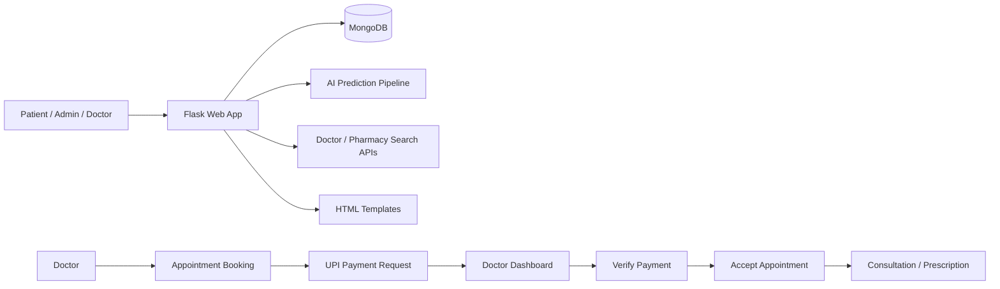

# Medico System Architecture

## 1. Overview

Medico is a healthcare and doctor-consultation web application built with Python and Flask. It supports patient registration, doctor discovery, symptom-based AI predictions, appointment booking, doctor approval workflow, UPI payment verification, consultation handling, and medication prescription management.

The system uses MongoDB as its primary data store and server-rendered HTML templates for the frontend.

---

## 2. High-Level Architecture

---

## 3. Main Components

### 3.1 Frontend Layer
The frontend is built using Flask templates with Jinja2 rendering.

Key template folders:
- templates/
  - home.html
  - login.html
  - register.html
  - dashboard.html
  - doctor.html
  - doctor_dashboard.html
  - book_appointment.html
  - appointment_payment.html
  - admin.html
  - prescribe.html
  - video_consultation.html

This layer handles:
- user authentication
- doctor search and filters
- appointment booking
- payment page
- admin dashboard
- doctor portal UI
- patient consultation flow

### 3.2 Application Layer
Main application logic is centralized in:
- app.py

This file contains:
- Flask app setup
- MongoDB connection
- user authentication
- doctor search and backend logic
- appointment booking route
- payment handling
- dashboard, record, prescription, admin, and analytics modules

### 3.3 Doctor Portal Layer
Doctor-specific logic is separated into:
- doctor_routes.py

This handles:
- doctor login and session validation
- dashboard aggregation
- patient listing
- accept/reschedule/cancel appointment logic
- payment verification
- notifications for doctors and patients

### 3.4 AI / Prediction Layer
The AI and model-related logic is under:
- src/
  - pipeline/
  - components/
  - utils/

This includes:
- prediction pipeline
- data ingestion
- data transformation
- model evaluation
- model training
- validation utilities

### 3.5 External API / Search Layer
The project uses external search and mapping services:
- doctor_service.py
- map_builder.py
- src/api/

This supports:
- doctor lookup and filtering
- pharmacy and map-related data
- location aware search features

---

## 4. Database Architecture

MongoDB is the main database and stores collections such as:

- users
- doctors
- consultations
- prescriptions
- medical_records
- symptom_history
- emergency_contacts
- doctor_notifications
- patient_notifications
- referrals
- ipd_requests

### Primary data flow
- Patients are stored in users
- Doctors are stored in doctors
- Appointment requests are stored in consultations
- Doctor responses and patient confirmations update the same consultation record
- Prescriptions are stored separately in prescriptions
- Notifications are stored in doctor_notifications and patient_notifications

---

## 5. Booking and Payment Flow

The core workflow is as follows:

1. Patient searches for doctor
2. Patient opens booking form
3. Patient selects date and time
4. Appointment is inserted into consultations with status such as Payment Pending
5. UPI request page is shown to patient
6. Patient marks payment as sent
7. Doctor receives notification and verifies payment
8. Doctor accepts the appointment request
9. Appointment moves to Waiting / Confirmed state
10. Video consultation or prescription workflow follows

### Important business rule
The appointment is not accepted on mere booking. It follows the sequence:
- booking request
- payment request
- doctor verification
- doctor acceptance

This ensures the doctor controls whether the appointment is confirmed.

---

## 6. Admin Layer

The admin is configured in the main app and can manage:
- doctor records
- doctor search and sorting
- doctor editing
- doctor deletion
- doctor detail view with patient visits

Admin routes are defined in app.py and include:
- /admin
- /admin/doctor/<doctor_id>
- /admin/doctor/<doctor_id>/edit
- /admin/doctor/<doctor_id>/delete

---

## 7. Security and Session Model

The project uses:
- Flask sessions for login state
- Flask-Login for user sessions
- password hashing with Werkzeug
- MongoDB-backed user records

Doctor sessions are managed separately using doctor_id stored in session.

---

## 8. Deployment / Runtime Setup

Project runtime files include:
- requirements.txt
- setup.py
- render.yaml
- app.py

Typical runtime components:
- Python web app
- MongoDB service
- static assets and template rendering
- AI model pipeline for medical prediction

---

## 9. Suggested Runtime Modules

### Patient side
- login and registration
- doctor search/filter
- appointment booking
- payment request UI
- dashboard view
- records and prescription history

### Doctor side
- login
- patient queue
- future booking verification
- doctor notifications
- prescribe and consultation tools
- reschedule and cancel actions

### Admin side
- doctor directory
- sort and filter
- doctor management
- patient visit history

---

## 10. Current Architecture Pattern

The project follows a modular monolith design:
- one Flask app entry point
- blueprint-based separation for doctor routes
- domain modules grouped by responsibility
- MongoDB for persistence
- template-driven UI
- background logic handled by route functions

This is a good fit for a mid-size healthcare application with moderate complexity and fast iteration.

---

## 11. Key Files

- app.py — main Flask application and route logic
- doctor_routes.py — doctor portal and appointment actions
- doctor_service.py — doctor and pharmacy search logic
- map_builder.py — map-related search rendering
- src/ — ML and utility modules
- templates/ — HTML interface files
- static/ — CSS, icons, and frontend assets
- config/ — config files such as YAML settings
- artifacts/ — data and uploads

---

## 12. Summary

Medico is a healthcare platform combining patient journey, doctor management, AI-driven prediction, and appointment workflows in a single Flask-based application. The system architecture is centered around a modular Flask app, MongoDB persistence, and doctor-driven confirmation flow that includes payment validation and consultation management.
